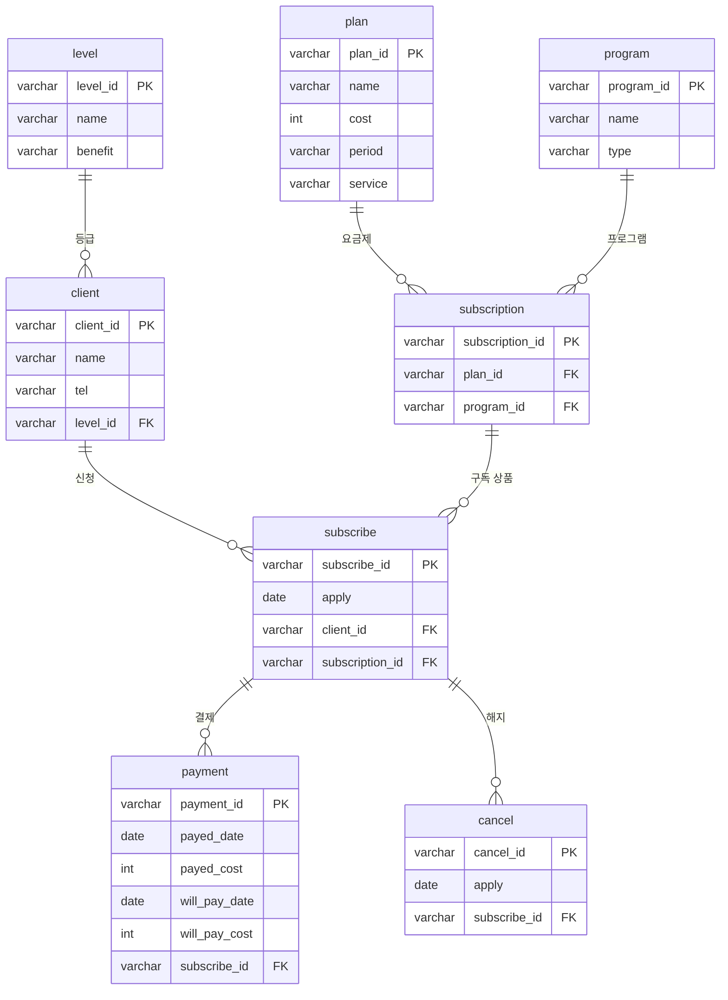

# 온라인 유료 구독 시스템 DB

OTT, 잡지, 게임, 편집툴, 도서, 음악 서비스를 한곳에서 구독하고 결제·해지까지 관리하는 온라인 유료 구독 시스템의 데이터베이스 설계 프로젝트입니다.
테이블 모델링부터 샘플 데이터 입력, 업무 질의 쿼리 작성까지 MySQL로 구현했습니다.

## 1. 프로젝트 개요

- 목적: 구독 서비스의 회원, 요금제, 구독, 결제, 해지 정보를 관계형 DB로 설계하고 SQL로 조회·수정
- DBMS: MySQL 8.0 (MySQL Workbench로 모델링 및 Forward Engineering)
- 스키마명: `subscription_system` (문자셋 utf8)
- 샘플 데이터 기간: 2025.06 ~ 2025.11 (6개월)

## 2. 설계 규칙

- 구독 상품(`subscription`)은 **프로그램 × 요금제 조합**입니다. 프로그램 59개에 요금제 3단계(베이직·스탠다드·프리미엄)를 곱해 177개로 구성했습니다.
- 회원은 구독 상품을 직접 갖지 않고 `subscribe`(구독 내역)로 연결합니다. 같은 상품을 여러 회원이 구독할 수 있습니다.
- 결제는 한 행에 **결제된 날짜·금액**과 **결제 예정일·예정 금액**을 함께 기록합니다.
- 해지는 결제 예정일 전에 신청해야 하며, 해지 내역이 없는 구독 내역을 구독 중으로 봅니다.
- 등급은 누적 결제 금액을 기준으로 하며 VVIP는 누적 100만 원 이상입니다. 샘플 데이터가 6개월치라 VVIP 회원은 없습니다.

## 3. ERD



## 4. 테이블 구성

| 테이블 | 설명 | 주요 컬럼 | 데이터 수 |
|---|---|---|---|
| `level` | 회원 등급과 혜택 | level_id, name, benefit | 4 |
| `client` | 회원 | client_id, name, tel, level_id | 30 |
| `program` | 구독 가능한 서비스 | program_id, name, type | 59 |
| `plan` | 요금제 | plan_id, name, cost, period, service | 18 |
| `subscription` | 프로그램과 요금제의 조합 (구독 상품) | subscription_id, plan_id, program_id | 177 |
| `subscribe` | 회원의 구독 신청 내역 | subscribe_id, apply, client_id, subscription_id | 115 |
| `payment` | 결제 완료·예정 내역 | payment_id, payed_date, payed_cost, will_pay_date, will_pay_cost, subscribe_id | 334 |
| `cancel` | 해지 신청 내역 | cancel_id, apply, subscribe_id | 28 |

### 프로그램 유형

| 유형 | 프로그램 수 | 예시 |
|---|---|---|
| 잡지 | 10 | 보그, 지큐, 엘르, 내셔널지오그래픽 |
| OTT | 9 | 넷플릭스, 디즈니플러스, 티빙, 웨이브 |
| 게임 | 10 | Xbox 게임패스, PS Plus, 닌텐도 온라인 |
| 편집툴 | 10 | 어도비, 피그마, 캔바, 스케치업 |
| 도서 | 10 | 밀리의 서재, 리디 셀렉트, 윌라 |
| 음악 | 10 | 멜론, 스포티파이, 유튜브 뮤직, 플로 |

### 요금제 (월 요금, 원)

| 유형 | 베이직 | 스탠다드 | 프리미엄 |
|---|---|---|---|
| 잡지 | 3,900 | 6,900 | 9,900 |
| OTT | 4,900 | 7,900 | 10,900 |
| 게임 | 3,900 | 6,900 | 9,900 |
| 편집툴 | 5,900 | 8,900 | 11,900 |
| 도서 | 4,900 | 7,900 | 10,900 |
| 음악 | 5,900 | 8,900 | 11,900 |

### 회원 등급

| 등급 | 혜택 |
|---|---|
| 일반 | 기본 서비스 제공 (할인 없음) |
| 우수 | 매달 1,000원 할인 쿠폰 1매 |
| VIP | 매달 1,000원 할인 쿠폰 3매 |
| VVIP | 매달 1,000원 할인 쿠폰 5매 + CS 우선 처리 |

## 5. 실행 방법

1. MySQL Workbench에서 `온라인_유료_구독_시스템_DDL.sql`을 실행해 스키마와 테이블을 생성합니다.
2. 외래키 순서에 맞춰 DML 파일을 아래 순서대로 실행합니다.

| 순서 | 파일 | 입력 테이블 |
|---|---|---|
| 1 | `[등급] DML.sql` | level |
| 2 | `[프로그램] DML.sql` | program |
| 3 | `[요금제] DML.sql` | plan |
| 4 | `[구독제] DML.sql` | subscription |
| 5 | `[회원] DML.sql` | client |
| 6 | `[구독내역] DML.sql` | subscribe |
| 7 | `[결제내역] DML.sql` | payment |
| 8 | `[해지내역] DML.sql` | cancel |

3. `질문 쿼리.sql`로 조회 및 수정 쿼리를 실행합니다.

> `[결제내역] DML.sql` 마지막에는 결제 금액과 예정 금액을 요금제 가격(`plan.cost`)에 맞추는 `UPDATE`가 포함되어 있습니다.

## 6. 질의 쿼리

`질문 쿼리.sql`에 업무 상황별 쿼리 9개가 있습니다.

| 번호 | 내용 | 사용 기능 |
|---|---|---|
| 1 | 누적 20만 원 이상 결제한 회원 | JOIN, GROUP BY, HAVING |
| 2 | 특정 회원의 2025년 12월 결제 예정 금액 | JOIN, SUM, 기간 조건 |
| 3 | 특정 회원의 구독 내역 (해지 신청일 포함) | 다중 JOIN, LEFT JOIN |
| 4 | 7개 이상 구독 중인 회원 | LEFT JOIN으로 해지 제외, COUNT, HAVING |
| 5 | 특정 회원 등급 변경(일반 → 우수) 후 조회 | UPDATE |
| 6 | 2025년 9월 12일 결제한 회원 | 다중 JOIN, 날짜 조건 |
| 7 | 신규 회원 가입 후 조회 | INSERT |
| 8 | 특정 회원의 신규 구독 신청 후 조회 | INSERT, 다중 JOIN |
| 9 | 2025년 11월 해지 신청 내역 | 다중 JOIN, 기간 조건 |

5, 7, 8번은 데이터를 변경하므로 조회 쿼리를 먼저 실행하거나 테스트용 DB에서 실행하세요.

## 7. 파일 구성

```
├── 온라인_유료_구독_시스템.mwb        # MySQL Workbench 모델
├── 온라인_유료_구독_시스템_DDL.sql    # 스키마·테이블 생성
├── [등급] DML.sql
├── [프로그램] DML.sql
├── [요금제] DML.sql
├── [구독제] DML.sql
├── [회원] DML.sql
├── [구독내역] DML.sql
├── [결제내역] DML.sql
├── [해지내역] DML.sql
└── 질문 쿼리.sql
```
